<div align="right">

**English** | [简体中文](README_zh.md)

</div>

<div align="center">

# StatePortal

### Agentic Checkpoint Synthesis for Testing Deep States in Interactive Software

<p>
  
  
  
</p>

<p>
  <a href="#overview">Overview</a> ·
  <a href="#deepstatebench">Benchmark</a> ·
  <a href="#results">Results</a> ·
  <a href="#quick-start">Quick Start</a> ·
  <a href="#documentation">Docs</a> ·
  <a href="#citation">Citation</a>
</p>

<p>🎆 <b>News:</b> We release the website <a href="https://stateportal.mineyosemite.chatgpt.site/">https://stateportal.mineyosemite.chatgpt.site/</a>!</p>

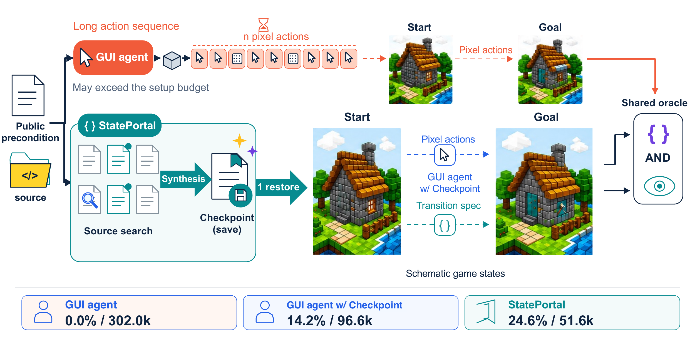

</div>

## Overview

Testing interactive software often requires a **deep state**: one that takes a long interaction history to reach, and whose cost recurs on every commit. GUI automation that could amortize this cost assumes a DOM or accessibility tree, which self-rendered engines do not expose.

**StatePortal** is an agent that reads a natural-language functional test case and the target's source code (read-only), then synthesizes a **checkpoint**: a versionable, replayable artifact that restores the required state through a per-application **hook**. Because a checkpoint can pass state checks while rendering incorrectly, every result is scored by a **hybrid oracle** that requires both a programmatic-state check and a visual check to pass.

**DeepStateBench** releases 61 deep-state tasks across 10 applications, spanning five language families and six rendering stacks, from 874 lines of source (2048) to 7.2M lines (LibreOffice).

- **End-to-end success.** Across three registered models, StatePortal completes **27.5%** of trials, compared with 10.4% for a GUI agent seeded with synthesized checkpoints and 0% for an unseeded GUI agent in the same pixel action space.
- **Replayability.** Over 1,361 replays of 112 checkpoints, **98.90%** reproduce the original verdict with zero model calls.
- **Visual faults.** The hybrid oracle detects **96.25%** of controlled visual faults that programmatic-state checks alone cannot see.

## Method

<div align="center">
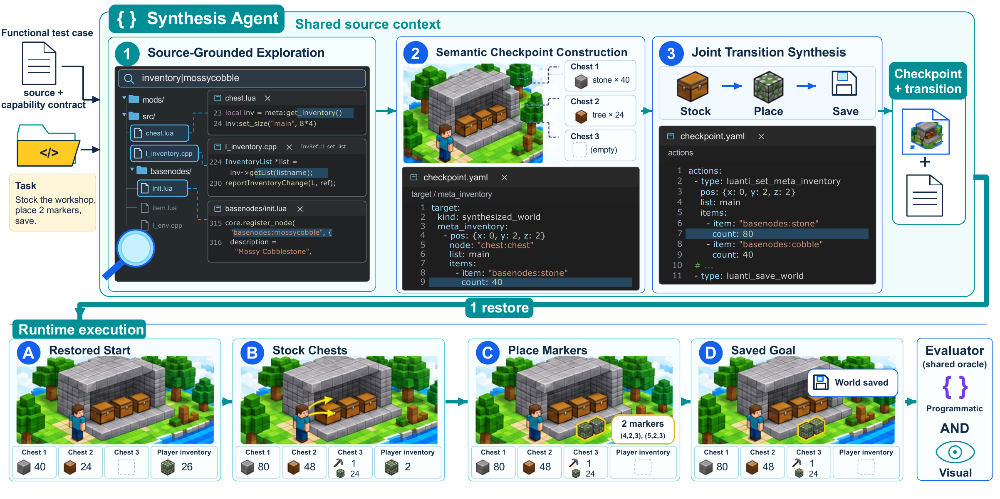
</div>

1. **Checkpoint synthesis.** The synthesis agent explores the repository to find the state variables the test case refers to. It then writes a checkpoint (the Start state) and a transition spec (the target action), both as configuration. It never edits product source.
2. **One-time hook onboarding.** An onboarding agent binds an existing state surface, or synthesizes a test-gated hook, once per application. No hook code is written by hand. After onboarding, each new test needs only a new checkpoint.
3. **Hybrid evaluation.** A trial passes only if `O_prog AND O_vis` holds at both the Start gate and the Goal gate. `O_prog` reads semantic state, persistence round-trips, and runtime health. `O_vis` is a VLM judge that compares the frame against a hidden golden image and rubric, calibrated against a blinded cross-VLM reference.

## DeepStateBench

<table>
  <tr>
    <td width="20%" align="center">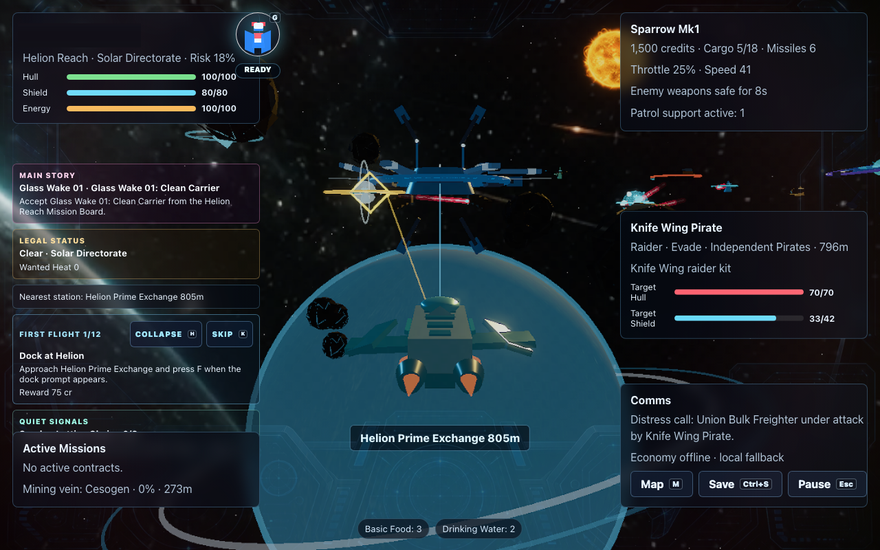<br><sub><b>SpaceRPG</b></sub></td>
    <td width="20%" align="center">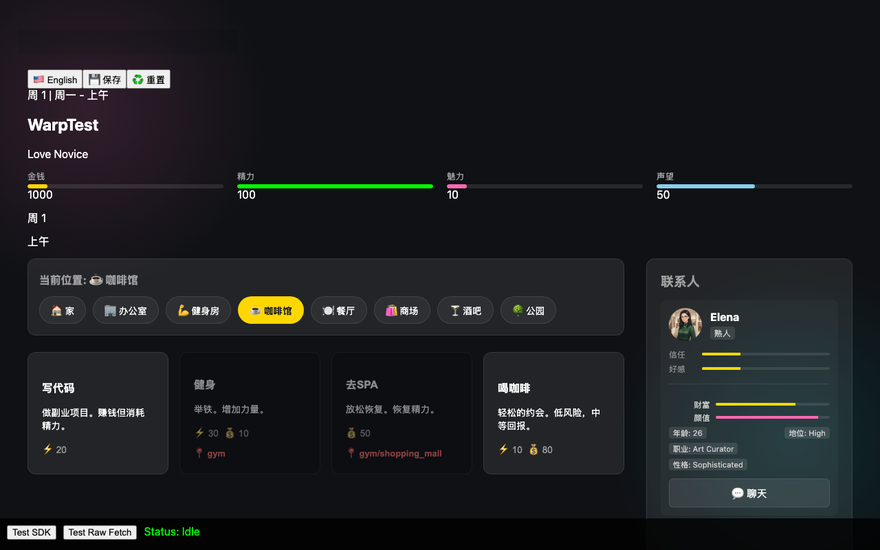<br><sub><b>DatingSim</b></sub></td>
    <td width="20%" align="center">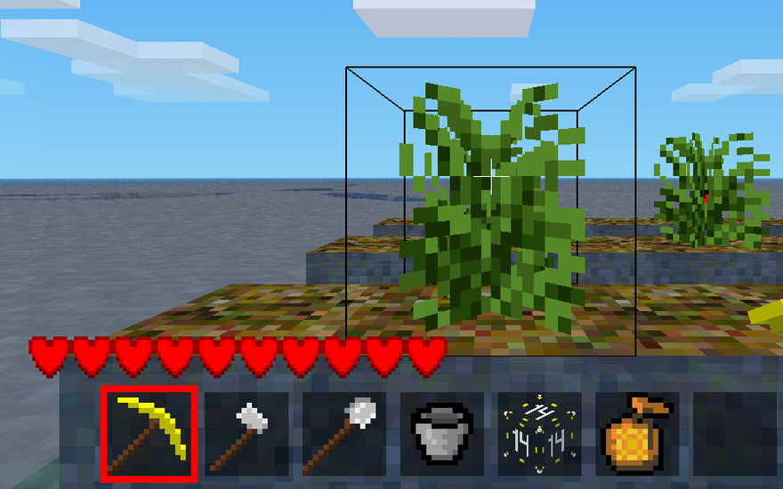<br><sub><b>Luanti</b></sub></td>
    <td width="20%" align="center">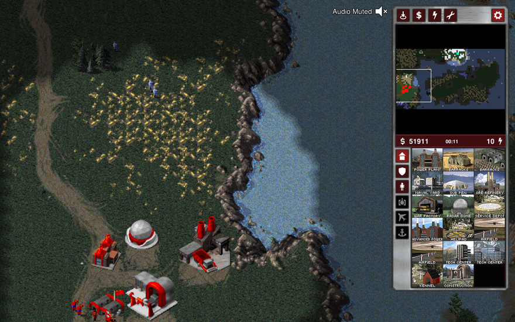<br><sub><b>OpenRA</b></sub></td>
    <td width="20%" align="center">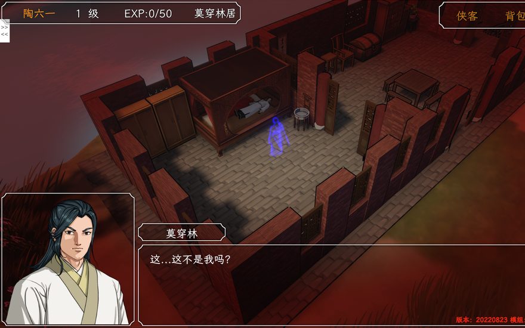<br><sub><b>jynew</b></sub></td>
  </tr>
  <tr>
    <td width="20%" align="center">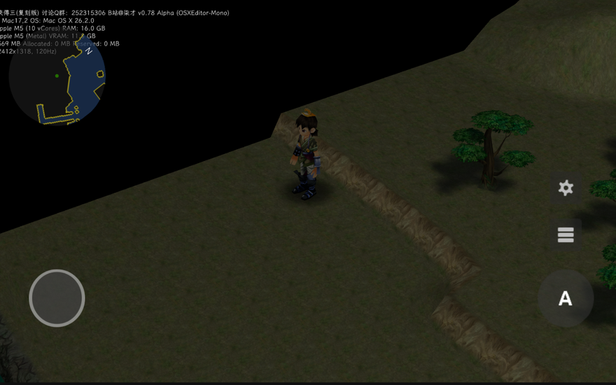<br><sub><b>PAL3</b></sub></td>
    <td width="20%" align="center">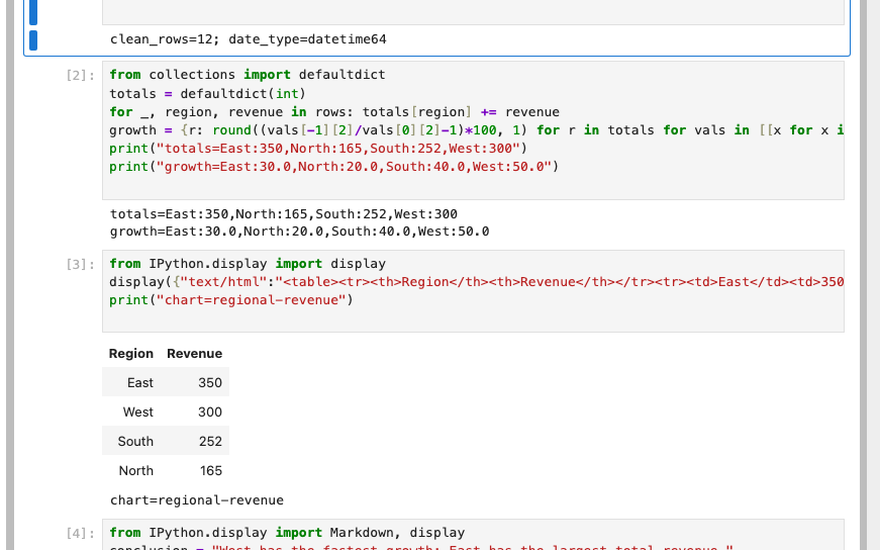<br><sub><b>JupyterLab</b></sub></td>
    <td width="20%" align="center">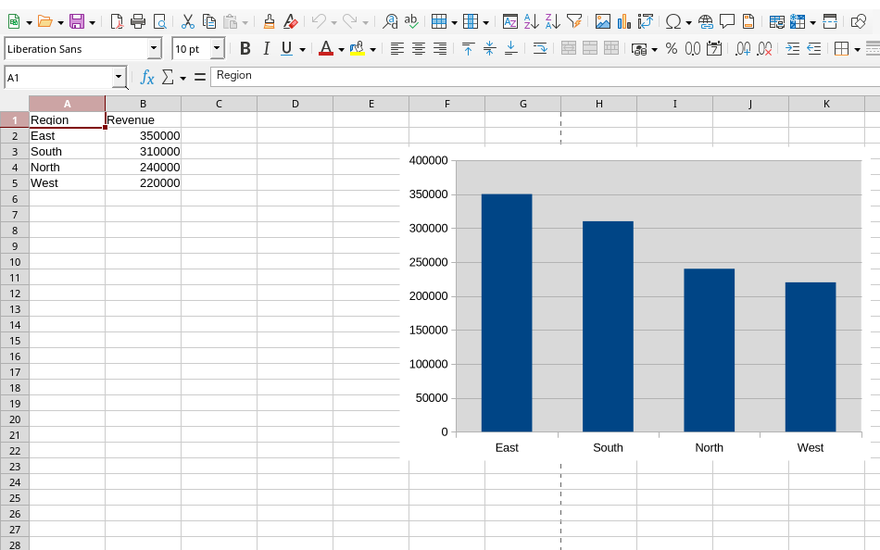<br><sub><b>LibreOffice</b></sub></td>
    <td width="20%" align="center">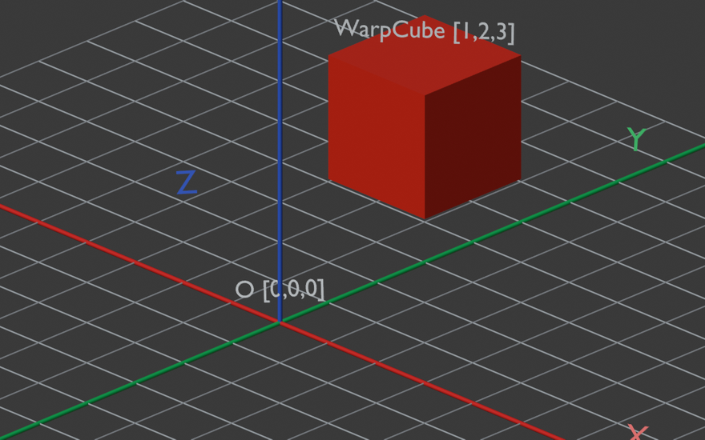<br><sub><b>Blender</b></sub></td>
    <td width="20%" align="center">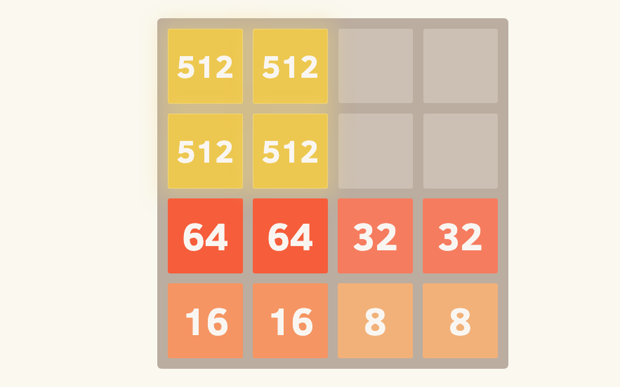<br><sub><b>2048</b></sub></td>
  </tr>
</table>

Eight applications are git submodules under `games/`, pinned to the commits below; `git submodule status -- games/` verifies a checkout. SpaceRPG and DatingSim are placeholder names for two open-source browser games whose upstream repositories are withheld during anonymous review, so their 15 tasks cannot be re-run from this repository. [`benchmarks/p5/c1_public_task_ids.txt`](benchmarks/p5/c1_public_task_ids.txt) lists the other 46 tasks (see [Reproducing the Paper](#reproducing-the-paper)).

| Application | Domain | Language | kLOC | Tasks | Upstream @ pinned commit |
| --- | --- | --- | ---: | ---: | --- |
| 2048 | browser puzzle | JavaScript | 0.9 | 8 | [gabrielecirulli/2048 @ `8b5c8a89`](https://github.com/gabrielecirulli/2048/commit/8b5c8a899a4acfd3258ad76e0af8e35a6bf7a3b9) |
| SpaceRPG | browser space RPG | TypeScript | 11 | 8 | withheld |
| DatingSim | browser dating sim | TypeScript | 2.7 | 7 | withheld |
| Luanti | native voxel engine | C++/Lua | 245 | 8 | [luanti-org/luanti @ `ba414e29`](https://github.com/luanti-org/luanti/commit/ba414e29fddf52337b16d673e17f87165bab3eff) |
| OpenRA | native RTS engine | C#/Lua | 283 | 5 | [OpenRA/OpenRA @ `7e687f43`](https://github.com/OpenRA/OpenRA/commit/7e687f430ee5b194c0ffaa06caaba757dd9155fb) |
| JupyterLab | notebook IDE | TypeScript/Python | 277 | 5 | [jupyterlab/jupyterlab @ `4a19f8ff`](https://github.com/jupyterlab/jupyterlab/commit/4a19f8fff4049a9536e21fa2980fe7e5ee592d01) |
| jynew | Unity wuxia RPG | C#/Lua | 53 | 5 | [jynew/jynew @ `be27d953`](https://github.com/jynew/jynew/commit/be27d95303cb1915bdfbcfe15046fa3f937b7eb7) |
| PAL3 | Unity RPG remake | C# | 59 | 5 | [0x7c13/Pal3.Unity @ `577017d9`](https://github.com/0x7c13/Pal3.Unity/commit/577017d943751a81886604a7744996e9ac968318) |
| LibreOffice | office suite (UNO) | C++/Python | 7,190 | 5 | [LibreOffice/core @ `3f840702`](https://github.com/LibreOffice/core/commit/3f84070274f87588c9ef69e9ea9e2426335392c8) |
| Blender | creative tool (`bpy`) | C++/Python | 2,766 | 5 | [blender/blender @ `3d018bca`](https://github.com/blender/blender/commit/3d018bcabdaeea66cf4ef4a96ce8913164831f6e) |

Tasks are derived mechanically from source metrics (complexity, churn, mutation kill rate), and their ground truth is recorded from a controlled real execution. Oracles and golden images are released in `specs/` for auditing but are never visible to the agent: it explores a sandboxed clone of the application only, and the repository tools hide `specs/`, `benchmarks/**/hidden/`, and the harness scripts (see [`docs/c1_EVALUATION_CONTRACT.md`](docs/c1_EVALUATION_CONTRACT.md)). The task catalog is [`benchmarks/p5/c1_tasks.yaml`](benchmarks/p5/c1_tasks.yaml); see [`docs/metric-grounded-provenance.md`](docs/metric-grounded-provenance.md) for the provenance pipeline.

## Results

Performance study on DeepStateBench (61 tasks × 3 seeds per row). **Ckpt.** marks rows that start from a restored synthesized checkpoint. Agent S3 and CUA Agent act only through pixels; StatePortal also delivers the target action through the hook.

| Model | Agent | Ckpt. | Start (%) ↑ | Goal \| Start (%) ↑ | **E2E (%)** ↑ | Tokens (k) ↓ | Cost ($) ↓ | Time (s) ↓ | TiPS (s) ↓ |
| --- | --- | :---: | ---: | ---: | ---: | ---: | ---: | ---: | ---: |
| gpt-5.6-terra | Agent S3 | ✗ | 8.7 | 0.0 | 0.0 | 302.0 | 1.148 | 234 | — |
| | Agent S3 | ✓ | 30.1 | 47.3 | 14.2 | 96.6 | 0.367 | 81 | 569.0 |
| | CUA Agent | ✗ | 10.9 | 0.0 | 0.0 | 193.2 | 0.734 | 126 | — |
| | CUA Agent | ✓ | 33.9 | 37.1 | 12.6 | 56.1 | 0.213 | 38 | 303.4 |
| | **StatePortal** | ✓ | 30.6 | 80.4 | **24.6** | 51.6 | 0.196 | 41 | 166.6 |
| gemini-3.5-flash | Agent S3 | ✗ | 7.1 | 0.0 | 0.0 | 554.3 | 1.580 | 323 | — |
| | Agent S3 | ✓ | 47.0 | 24.4 | 11.5 | 181.4 | 0.517 | 159 | 1386.9 |
| | CUA Agent | ✗ | 12.6 | 13.0 | 1.6 | 444.0 | 1.265 | 241 | 14694.4 |
| | CUA Agent | ✓ | 51.9 | 21.1 | 10.9 | 119.6 | 0.341 | 100 | 917.6 |
| | **StatePortal** | ✓ | 50.3 | 70.7 | **35.5** | 115.1 | 0.328 | 84 | 236.2 |
| kimi-k2.6 | Agent S3 | ✗ | 7.7 | 0.0 | 0.0 | 368.6 | 0.552 | 294 | — |
| | Agent S3 | ✓ | 32.8 | 16.7 | 5.5 | 213.4 | 0.320 | 115 | 2111.2 |
| | CUA Agent | ✗ | 8.7 | 18.8 | 1.6 | 404.6 | 0.607 | 285 | 17357.2 |
| | CUA Agent | ✓ | 33.9 | 16.1 | 5.5 | 175.2 | 0.263 | 88 | 1613.8 |
| | **StatePortal** | ✓ | 34.4 | 65.1 | **22.4** | 153.5 | 0.230 | 68 | 305.4 |
| gpt-6-astra | Agent S3 | ✗ | 21.3 | 0.0 | 0.0 | 248.9 | 4.280 | 205 | — |
| | Agent S3 | ✓ | 48.1 | 29.5 | 14.2 | 162.6 | 2.797 | 128 | 903.4 |
| | CUA Agent | ✗ | 18.0 | 21.2 | 3.8 | 233.7 | 4.020 | 164 | 4296.4 |
| | CUA Agent | ✓ | 46.4 | 30.6 | 14.2 | 146.7 | 2.524 | 94 | 660.0 |
| | **StatePortal** | ✓ | 48.1 | 63.6 | **30.6** | 135.7 | 2.333 | 87 | 285.8 |

*Start* and *E2E* are success rates; *Goal | Start* is conditioned on trials that reached Start. Tokens, cost, and time are per-trial means that include terminal failures, and time includes synthesis. *TiPS* is total time per E2E success; "—" means no success. Cost prices each trial's tokens at its decision model's public catalog rate.

## Quick Start

**Requirements.** Python 3.11+, Node 18+, and Chromium (installed through Playwright). Browser apps run on Linux and macOS. The paper numbers were produced on macOS 26.2 / Apple Silicon with a 3024×1964 display; the native background backends (Luanti, OpenRA, Unity, Blender, LibreOffice) rely on macOS window APIs, and checking out every application takes tens of GB of disk.

**1. Install.** Download the repository from [the anonymous mirror](https://anonymous.4open.science/r/State_Portal-BB4E), then fetch only the applications you need at their pinned commits (the Quick Start needs only 2048):

```bash
cd State_Portal                      # the extracted repository root
scripts/fetch_apps.sh 2048           # in a git checkout: git submodule update --init --depth 1 games/2048
uv sync --extra test                 # or: python3.11 -m venv .venv && . .venv/bin/activate && pip install -e ".[test]"
uv run playwright install chromium
source .venv/bin/activate            # all commands below assume `python` is this 3.11+ environment
```

**2. Sanity check** with no API key: a deterministic agent and a fake visual judge exercise the full synthesize, restore, execute, and grade pipeline on the three 2048 tasks.

```bash
WARPTEST_VISUAL_JUDGE_FAKE=correct python -m warptest core-bench \
  --tasks benchmarks/core/public/tasks_quickstart.yaml \
  --grading explore-execute --agent deterministic --oracle-policy fake-visual
```

This takes about 10 s and ends with a JSON summary containing `"total_tasks": 3`, `"explore_execute_success": 3`, and the report directory under `reports/warptest/`.

**3. Restore and validate one checkpoint** on a real runtime (about 2 s; prints `"status": "success"`):

```bash
python -m warptest inspect games/2048
python -m warptest run specs/2048/merge-left.yaml --repo games/2048
```

**4. Synthesize checkpoints with a model**:

```bash
export MODELSCOPE_API_KEY=...   # or route through any OpenAI-compatible gateway, see docs/runtimes.md
python -m warptest core-bench --tasks benchmarks/core/public/tasks_quickstart.yaml \
  --grading explore-execute --agent llm --model "<model-id>"
```

Browser apps need only Node and Chromium. Native engines (Luanti, OpenRA, Unity, Blender, LibreOffice) have extra build requirements, listed in [`docs/runtimes.md`](docs/runtimes.md). Runtimes that cannot run on a host are reported as `blocked`, never as failures.

### Model access

| Use case | Credentials |
| --- | --- |
| Quick Start and single-model runs | `MODELSCOPE_API_KEY`, or any OpenAI-compatible gateway (see [`docs/runtimes.md`](docs/runtimes.md)) |
| Registered paper runs (`p5-scale`, preflight, calibration) | OpenAI-compatible relay gateway key and base URL in `test_model_batch.py`; copy [`credentials.example.py`](credentials.example.py) |
| Visual judge override (optional) | `WARPTEST_VISUAL_JUDGE_API_KEY` |

The credential file is git-ignored and parsed as literals, never imported; its key is never written to a report.

## Reproducing the Paper

The registered experiments run from one manifest, [`benchmarks/p5/manifest.yaml`](benchmarks/p5/manifest.yaml):

```bash
python -m warptest p5-scale --seeds 3 --dry-run         # 60 invocations / 3,660 trials
# preflight + native canary + calibration gates, then:
python -m warptest p5-scale --seeds 3 --aggregate --headed --resume --report-dir reports/warptest/c1-formal \
  --preflight-artifact reports/warptest/c1-preflight.json \
  --calibration-artifact reports/warptest/c1-calibration.json
```

To skip the two withheld applications, add `--task-ids "$(paste -sd, benchmarks/p5/c1_public_task_ids.txt)"` (46 tasks, 2,760 trials).

See [`docs/reproduce.md`](docs/reproduce.md) for the gate commands, the visual-oracle calibration, and the resume and provenance rules.

| Claim | Configuration | Entry point | Model calls |
| --- | --- | --- | --- |
| Performance study (Results table) | [`benchmarks/p5/manifest.yaml`](benchmarks/p5/manifest.yaml) | `python -m warptest p5-scale --seeds 3 ...` | yes |
| Replayability (98.90%) | [`benchmarks/p5/replay_manifest.yaml`](benchmarks/p5/replay_manifest.yaml) | `python -m warptest replay-bench harvest / run / aggregate` | none |
| Visual-fault detection (96.25%) | `hybrid-v3` protocol | `python -m warptest visual-experiment --protocol hybrid-v3 ...` | judge and annotators |
| Latent-defect study | [`benchmarks/p5/lazarus_p2p_only_formal_seed0_manifest.yaml`](benchmarks/p5/lazarus_p2p_only_formal_seed0_manifest.yaml) | `python scripts/run_lazarus_p2p_only.py --run-root ...` | yes |
| Offline plumbing check (all apps checked out) | [`benchmarks/p5/manifest.yaml`](benchmarks/p5/manifest.yaml) | `python -m warptest p5-scale --smoke` | none |

## Naming

The code predates the paper title, so some internal names remain:

| In code | In the paper |
| --- | --- |
| `warptest` (package and CLI) | StatePortal harness |
| `p5`, `p5-scale` | DeepStateBench registered experiments |
| `c1_*`, `benchmarks/p5/c1_tasks.yaml` | performance study |
| `replay-bench`, `c4-replay`, `replay_manifest.yaml` | replay study |
| `lazarus*` | latent-defect study |
| `c1_agent_s` / `c1_agent_s_synth` (arms C / D) | Agent S3, cold / checkpoint-seeded |
| `c1_agent_scalecua` / `c1_agent_scalecua_synth` (arms F / G) | CUA Agent (ScaleCUA), cold / checkpoint-seeded |
| `c1_state` (arm E) | StatePortal |
| `c1_state_minimal_agent` | delegated-transition diagnostic |
| `love-*` task ids, `specs/love/` | DatingSim |

## Repository Layout

```text
warptest/             StatePortal harness: synthesis agent, runtimes, hooks, oracles, CLI
└── instrumentation/  test-gated hooks for native engines (Luanti, OpenRA, jynew, PAL3)
benchmarks/
├── p5/               DeepStateBench task catalog and registered manifests
│   └── lazarus/      real-defect tasks for the latent-defect study
├── onboarding/       hook-onboarding agent prompts and manifests
├── core/             Quick Start and development tasks
└── state_loop/ model/ segments/ upstream/   development benchmarks (not in the paper)
specs/                per-app checkpoint specs, hidden oracles, and visual goldens
games/                8 public applications as pinned git submodules
baselines/            GUI-agent baselines (Agent-S, ScaleCUA) as submodules
scripts/              aggregation and experiment launchers (see scripts/README.md)
tools/                Luanti control helper for the latent-defect study
docs/                 documentation (see below)
tests/                unit and integration tests
```

## Documentation

| Topic | Document |
| --- | --- |
| Model providers, visual judge, per-app runtime setup | [`docs/runtimes.md`](docs/runtimes.md) |
| CLI reference, Explore-Hard core bench, State Loop | [`docs/core-bench.md`](docs/core-bench.md) |
| Registered experiments, concurrency, and provenance | [`docs/reproduce.md`](docs/reproduce.md) |
| Formal-result identity, prompt revisions, and randomness contract | [`docs/c1_REPRODUCIBILITY.md`](docs/c1_REPRODUCIBILITY.md) |
| Scheduler, sandboxing, and resume contract | [`docs/c1_concurrency.md`](docs/c1_concurrency.md) |
| Uniform per-task budget | [`docs/c1_BUDGET_UNIFICATION.md`](docs/c1_BUDGET_UNIFICATION.md) |
| Hidden evaluation contract | [`docs/c1_EVALUATION_CONTRACT.md`](docs/c1_EVALUATION_CONTRACT.md) |
| Metric-grounded task provenance | [`docs/metric-grounded-provenance.md`](docs/metric-grounded-provenance.md) |
| Visual audit policy | [`docs/visual-audit-policy.md`](docs/visual-audit-policy.md) |
| Agent-S bridge | [`docs/agent_s_bridge.md`](docs/agent_s_bridge.md) |

## Troubleshooting

- **`ImportError: cannot import name 'UTC' from 'datetime'`**: the command ran under Python < 3.11 (e.g. the macOS system `python3`). Activate the environment from step 1.
- **A result is `blocked`**: the runtime is unavailable on this host (e.g. a native backend on Linux). It is excluded, not counted as a failure.
- **Browser apps only**: pass `--task-ids` with the `2048-*` and `jupyterlab-*` ids from `benchmarks/p5/c1_public_task_ids.txt`.

## Citation

```bibtex
@misc{anonymous2026stateportal,
  title  = {StatePortal: Agentic Checkpoint Synthesis for Testing Deep States in Interactive Software},
  author = {Anonymous},
  year   = {2026},
  note   = {Anonymous submission}
}
```

## Acknowledgements

DeepStateBench builds on the open-source projects [2048](https://github.com/gabrielecirulli/2048), [Luanti](https://github.com/luanti-org/luanti), [OpenRA](https://github.com/OpenRA/OpenRA), [JupyterLab](https://github.com/jupyterlab/jupyterlab), [jynew](https://github.com/jynew/jynew), [Pal3.Unity](https://github.com/0x7c13/Pal3.Unity), [LibreOffice](https://github.com/LibreOffice/core), and [Blender](https://github.com/blender/blender), plus two browser games credited after review. The GUI-agent baselines use [Agent-S](https://github.com/simular-ai/Agent-S) and [ScaleCUA](https://github.com/OpenGVLab/ScaleCUA).

## License

The code in this repository is released under the [MIT License](LICENSE). Each application and baseline submodule remains under its own license.
