<div align="right">

[English](README.md) | **简体中文**

</div>

<div align="center">

# StatePortal

### 面向交互式软件深层状态测试的智能体检查点合成

<p>
  
  
  
</p>

<p>
  <a href="#概述">概述</a> ·
  <a href="#deepstatebench">基准</a> ·
  <a href="#结果">结果</a> ·
  <a href="#快速开始">快速开始</a> ·
  <a href="#文档">文档</a> ·
  <a href="#引用">引用</a>
</p>

<p>🎆 <b>News：</b>项目网站 <a href="https://stateportal.mineyosemite.chatgpt.site/">https://stateportal.mineyosemite.chatgpt.site/</a> 正式上线！</p>

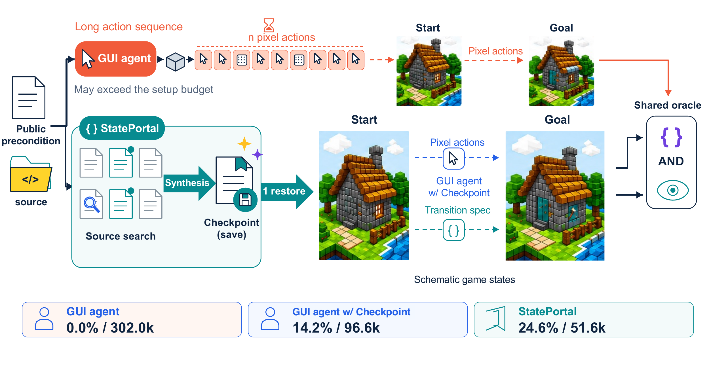

</div>

## 概述

测试交互式软件常常需要一个**深层状态**：到达它需要很长的交互历史，而且每次提交都要重复付出这份代价。能够摊销这份代价的 GUI 自动化依赖 DOM 或无障碍树，而自渲染引擎并不提供这些。

**StatePortal** 是一个智能体：它读取自然语言描述的功能测试用例和目标程序的源码（只读），然后合成一个**检查点**。检查点是一个可版本化、可重放的产物，通过每个应用各自的 **hook** 恢复所需状态。由于检查点可能通过了状态检查却渲染错误，每个结果都由**混合 oracle** 评分，要求程序化状态检查和视觉检查同时通过。

**DeepStateBench** 发布了覆盖 10 个应用的 61 个深层状态任务，涉及五个语言家族和六种渲染栈，源码规模从 874 行（2048）到 720 万行（LibreOffice）。

- **端到端成功率。** 在三个登记模型上，StatePortal 完成 **27.5%** 的 trial；在相同像素动作空间中，使用合成检查点作为起点的 GUI 智能体为 10.4%，不使用检查点的 GUI 智能体为 0%。
- **可重放性。** 对 112 个检查点共 1,361 次重放，**98.90%** 在零模型调用的情况下复现了原判定。
- **视觉缺陷。** 混合 oracle 检出了 **96.25%** 的受控视觉缺陷，这些缺陷仅靠程序化状态检查无法发现。

## 方法

<div align="center">
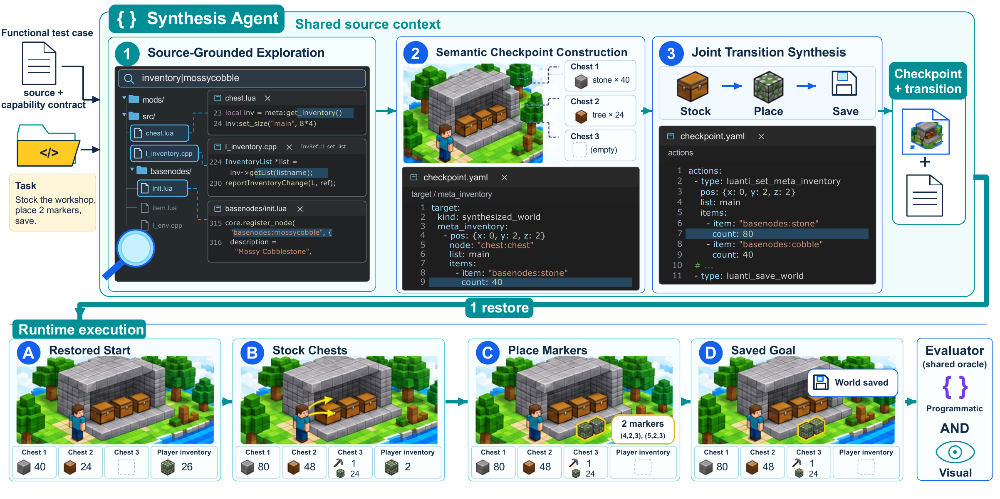
</div>

1. **检查点合成。** 合成智能体探索代码仓库，找到测试用例涉及的状态变量，然后以配置形式写出检查点（Start 状态）和转移规格（目标动作）。它从不修改产品源码。
2. **一次性 hook 接入。** 接入智能体为每个应用绑定一个已有的状态接口，或合成一个经测试把关的 hook，每个应用只做一次，不手写任何 hook 代码。接入之后，每个新测试只需要一个新的检查点。
3. **混合评估。** 只有当 Start 门和 Goal 门都满足 `O_prog AND O_vis` 时，trial 才算通过。`O_prog` 读取语义状态、持久化往返和运行时健康状况；`O_vis` 是一个 VLM 判官，将画面与隐藏的金标图和评分细则对比，并以盲评的跨 VLM 参考进行校准。

## DeepStateBench

<table>
  <tr>
    <td width="20%" align="center">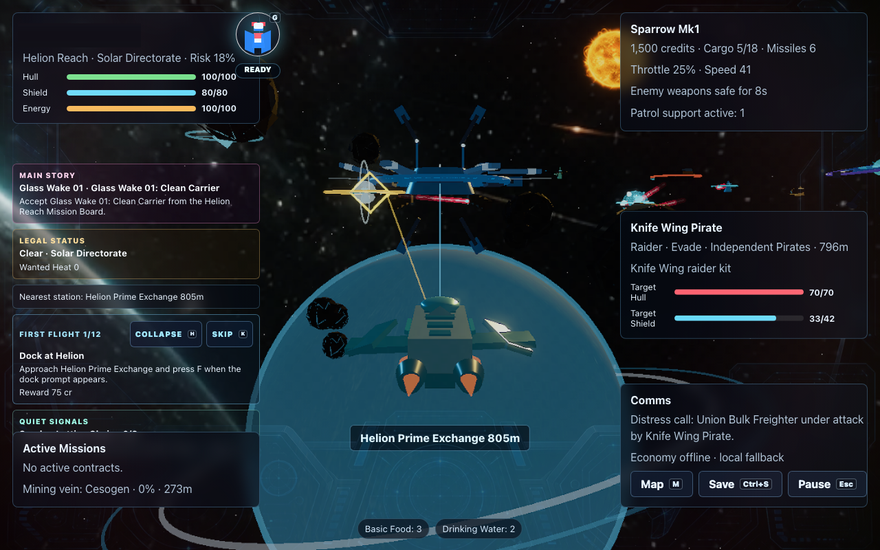<br><sub><b>SpaceRPG</b></sub></td>
    <td width="20%" align="center">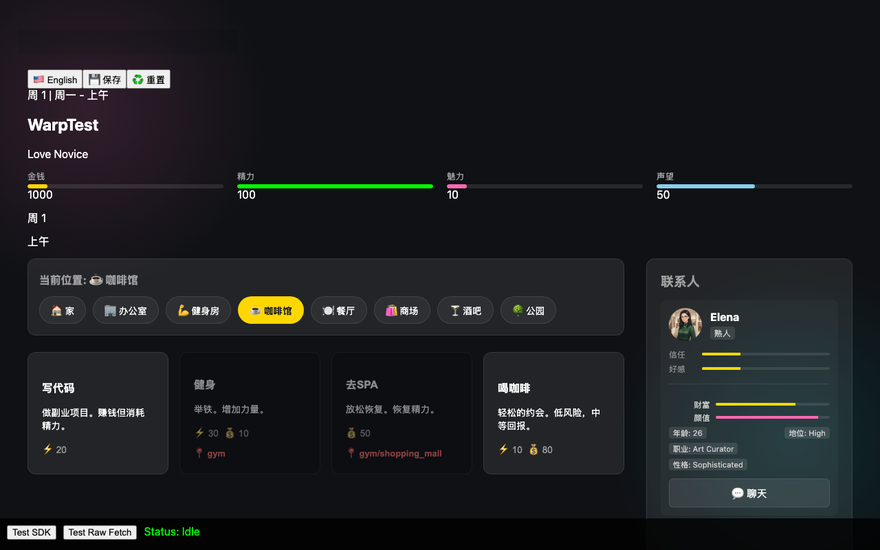<br><sub><b>DatingSim</b></sub></td>
    <td width="20%" align="center">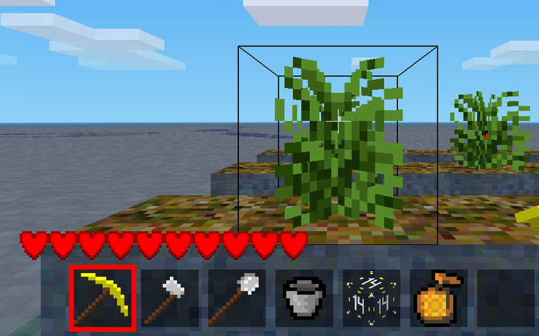<br><sub><b>Luanti</b></sub></td>
    <td width="20%" align="center">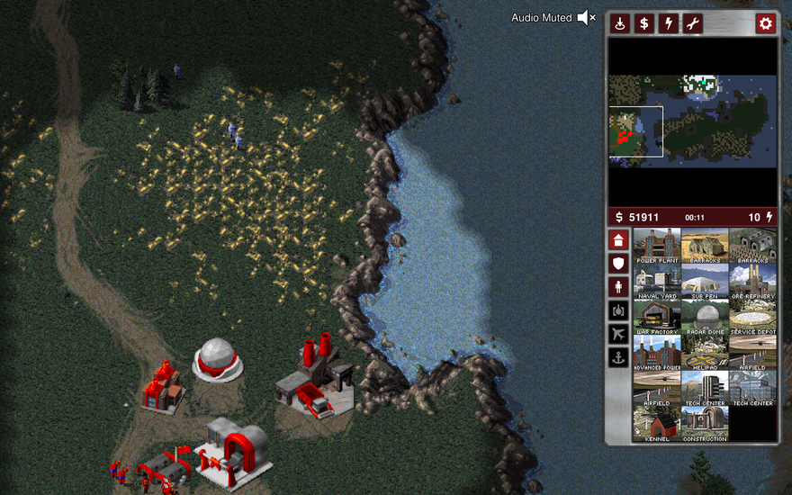<br><sub><b>OpenRA</b></sub></td>
    <td width="20%" align="center">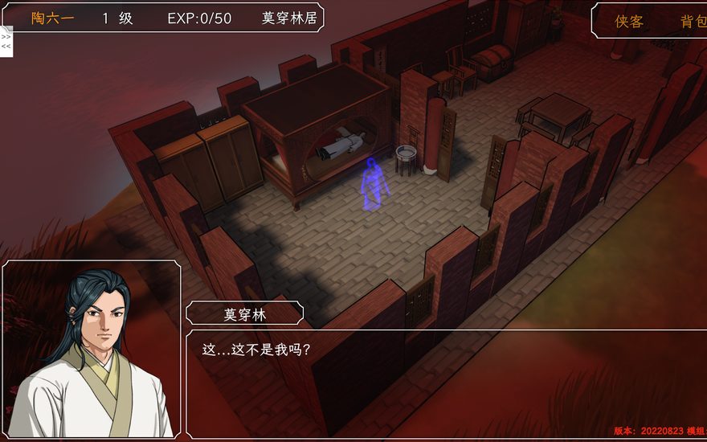<br><sub><b>jynew</b></sub></td>
  </tr>
  <tr>
    <td width="20%" align="center">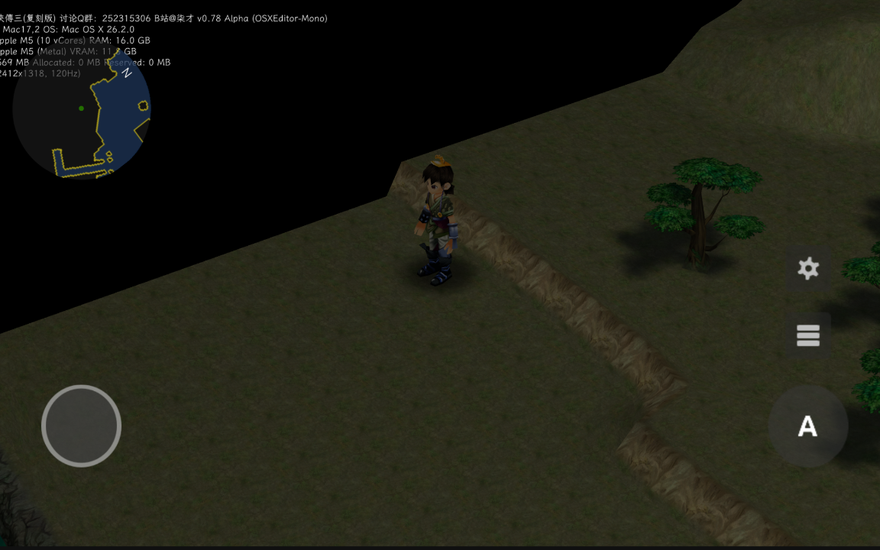<br><sub><b>PAL3</b></sub></td>
    <td width="20%" align="center">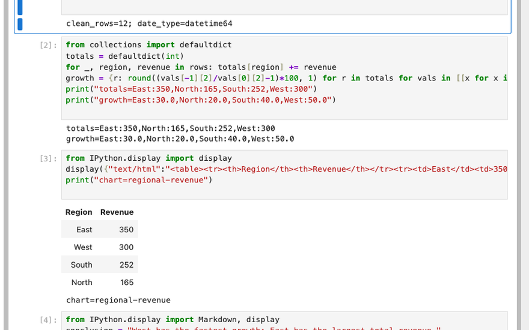<br><sub><b>JupyterLab</b></sub></td>
    <td width="20%" align="center">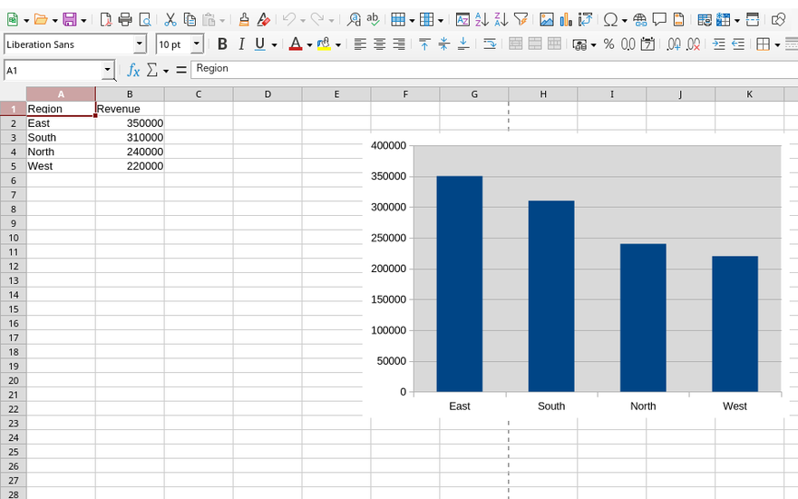<br><sub><b>LibreOffice</b></sub></td>
    <td width="20%" align="center">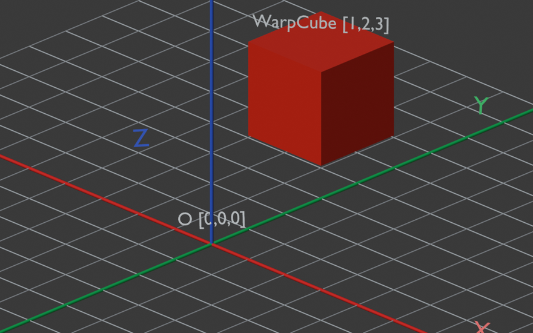<br><sub><b>Blender</b></sub></td>
    <td width="20%" align="center">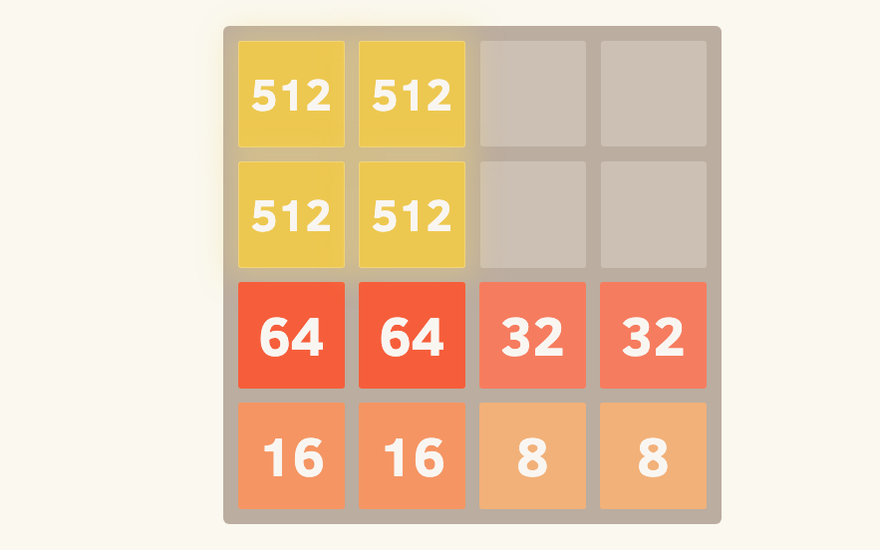<br><sub><b>2048</b></sub></td>
  </tr>
</table>

其中八个应用以 git 子模块的形式放在 `games/` 下，固定在下表所列的 commit；可用 `git submodule status -- games/` 校验。SpaceRPG 和 DatingSim 是两个开源浏览器游戏的占位名称，其上游仓库在匿名评审期间不公开，因此它们的 15 个任务无法从本仓库重跑。其余 46 个任务列在 [`benchmarks/p5/c1_public_task_ids.txt`](benchmarks/p5/c1_public_task_ids.txt)（见[复现论文](#复现论文)）。

| 应用 | 领域 | 语言 | kLOC | 任务数 | 上游 @ 固定 commit |
| --- | --- | --- | ---: | ---: | --- |
| 2048 | 浏览器益智 | JavaScript | 0.9 | 8 | [gabrielecirulli/2048 @ `8b5c8a89`](https://github.com/gabrielecirulli/2048/commit/8b5c8a899a4acfd3258ad76e0af8e35a6bf7a3b9) |
| SpaceRPG | 浏览器太空 RPG | TypeScript | 11 | 8 | 不公开 |
| DatingSim | 浏览器恋爱模拟 | TypeScript | 2.7 | 7 | 不公开 |
| Luanti | 原生体素引擎 | C++/Lua | 245 | 8 | [luanti-org/luanti @ `ba414e29`](https://github.com/luanti-org/luanti/commit/ba414e29fddf52337b16d673e17f87165bab3eff) |
| OpenRA | 原生 RTS 引擎 | C#/Lua | 283 | 5 | [OpenRA/OpenRA @ `7e687f43`](https://github.com/OpenRA/OpenRA/commit/7e687f430ee5b194c0ffaa06caaba757dd9155fb) |
| JupyterLab | 笔记本 IDE | TypeScript/Python | 277 | 5 | [jupyterlab/jupyterlab @ `4a19f8ff`](https://github.com/jupyterlab/jupyterlab/commit/4a19f8fff4049a9536e21fa2980fe7e5ee592d01) |
| jynew | Unity 武侠 RPG | C#/Lua | 53 | 5 | [jynew/jynew @ `be27d953`](https://github.com/jynew/jynew/commit/be27d95303cb1915bdfbcfe15046fa3f937b7eb7) |
| PAL3 | Unity RPG 重制 | C# | 59 | 5 | [0x7c13/Pal3.Unity @ `577017d9`](https://github.com/0x7c13/Pal3.Unity/commit/577017d943751a81886604a7744996e9ac968318) |
| LibreOffice | 办公套件（UNO） | C++/Python | 7,190 | 5 | [LibreOffice/core @ `3f840702`](https://github.com/LibreOffice/core/commit/3f84070274f87588c9ef69e9ea9e2426335392c8) |
| Blender | 创作工具（`bpy`） | C++/Python | 2,766 | 5 | [blender/blender @ `3d018bca`](https://github.com/blender/blender/commit/3d018bcabdaeea66cf4ef4a96ce8913164831f6e) |

任务依据源码指标（复杂度、变更频度、变异杀死率）机械地生成，真值由受控的真实执行记录得到。Oracle 和金标图发布在 `specs/` 中供审计，但智能体始终看不到：它只能探索应用的沙箱克隆，仓库工具会隐藏 `specs/`、`benchmarks/**/hidden/` 和评测脚本（见 [`docs/c1_EVALUATION_CONTRACT.md`](docs/c1_EVALUATION_CONTRACT.md)）。任务目录为 [`benchmarks/p5/c1_tasks.yaml`](benchmarks/p5/c1_tasks.yaml)；任务来源流程见 [`docs/metric-grounded-provenance.md`](docs/metric-grounded-provenance.md)。

## 结果

DeepStateBench 上的性能研究（每行 61 个任务 × 3 个 seed）。**Ckpt.** 表示该行从恢复的合成检查点开始。Agent S3 和 CUA Agent 只通过像素操作；StatePortal 还通过 hook 执行目标动作。

| 模型 | 智能体 | Ckpt. | Start (%) ↑ | Goal \| Start (%) ↑ | **E2E (%)** ↑ | Tokens (k) ↓ | 费用 ($) ↓ | 时间 (s) ↓ | TiPS (s) ↓ |
| --- | --- | :---: | ---: | ---: | ---: | ---: | ---: | ---: | ---: |
| gpt-5.6-terra | Agent S3 | ✗ | 8.7 | 0.0 | 0.0 | 302.0 | 1.148 | 234 | — |
| | Agent S3 | ✓ | 30.1 | 47.3 | 14.2 | 96.6 | 0.367 | 81 | 569.0 |
| | CUA Agent | ✗ | 10.9 | 0.0 | 0.0 | 193.2 | 0.734 | 126 | — |
| | CUA Agent | ✓ | 33.9 | 37.1 | 12.6 | 56.1 | 0.213 | 38 | 303.4 |
| | **StatePortal** | ✓ | 30.6 | 80.4 | **24.6** | 51.6 | 0.196 | 41 | 166.6 |
| gemini-3.5-flash | Agent S3 | ✗ | 7.1 | 0.0 | 0.0 | 554.3 | 1.580 | 323 | — |
| | Agent S3 | ✓ | 47.0 | 24.4 | 11.5 | 181.4 | 0.517 | 159 | 1386.9 |
| | CUA Agent | ✗ | 12.6 | 13.0 | 1.6 | 444.0 | 1.265 | 241 | 14694.4 |
| | CUA Agent | ✓ | 51.9 | 21.1 | 10.9 | 119.6 | 0.341 | 100 | 917.6 |
| | **StatePortal** | ✓ | 50.3 | 70.7 | **35.5** | 115.1 | 0.328 | 84 | 236.2 |
| kimi-k2.6 | Agent S3 | ✗ | 7.7 | 0.0 | 0.0 | 368.6 | 0.552 | 294 | — |
| | Agent S3 | ✓ | 32.8 | 16.7 | 5.5 | 213.4 | 0.320 | 115 | 2111.2 |
| | CUA Agent | ✗ | 8.7 | 18.8 | 1.6 | 404.6 | 0.607 | 285 | 17357.2 |
| | CUA Agent | ✓ | 33.9 | 16.1 | 5.5 | 175.2 | 0.263 | 88 | 1613.8 |
| | **StatePortal** | ✓ | 34.4 | 65.1 | **22.4** | 153.5 | 0.230 | 68 | 305.4 |
| gpt-6-astra | Agent S3 | ✗ | 21.3 | 0.0 | 0.0 | 248.9 | 4.280 | 205 | — |
| | Agent S3 | ✓ | 48.1 | 29.5 | 14.2 | 162.6 | 2.797 | 128 | 903.4 |
| | CUA Agent | ✗ | 18.0 | 21.2 | 3.8 | 233.7 | 4.020 | 164 | 4296.4 |
| | CUA Agent | ✓ | 46.4 | 30.6 | 14.2 | 146.7 | 2.524 | 94 | 660.0 |
| | **StatePortal** | ✓ | 48.1 | 63.6 | **30.6** | 135.7 | 2.333 | 87 | 285.8 |

*Start* 和 *E2E* 为成功率；*Goal | Start* 以到达 Start 的 trial 为条件。Tokens、费用和时间是包含终止失败在内的每 trial 均值，时间包含合成耗时。*TiPS* 为每次 E2E 成功所需的总时间，"—" 表示没有成功。费用按每个 trial 的决策模型公开目录价格计算。

## 快速开始

**环境要求。** Python 3.11+、Node 18+，以及通过 Playwright 安装的 Chromium。浏览器类应用可在 Linux 和 macOS 上运行。论文数据在 macOS 26.2 / Apple Silicon、3024×1964 显示器上得到；原生后台后端（Luanti、OpenRA、Unity、Blender、LibreOffice）依赖 macOS 窗口 API，检出全部应用需要数十 GB 磁盘空间。

**1. 安装。** 从[匿名镜像](https://anonymous.4open.science/r/State_Portal-BB4E)下载仓库，然后只拉取需要的应用到固定 commit（快速开始只需要 2048）：

```bash
cd State_Portal                      # 解压后的仓库根目录
scripts/fetch_apps.sh 2048           # 在 git 检出中：git submodule update --init --depth 1 games/2048
uv sync --extra test                 # 或：python3.11 -m venv .venv && . .venv/bin/activate && pip install -e ".[test]"
uv run playwright install chromium
source .venv/bin/activate            # 以下命令都假定 `python` 是这个 3.11+ 环境
```

**2. 无需 API key 的自检**：用确定性智能体和假视觉判官，在三个 2048 任务上跑通完整的合成、恢复、执行和评分流程。

```bash
WARPTEST_VISUAL_JUDGE_FAKE=correct python -m warptest core-bench \
  --tasks benchmarks/core/public/tasks_quickstart.yaml \
  --grading explore-execute --agent deterministic --oracle-policy fake-visual
```

约 10 秒完成，最后输出包含 `"total_tasks": 3`、`"explore_execute_success": 3` 的 JSON 摘要，报告目录位于 `reports/warptest/` 下。

**3. 在真实运行时上恢复并验证一个检查点**（约 2 秒，输出 `"status": "success"`）：

```bash
python -m warptest inspect games/2048
python -m warptest run specs/2048/merge-left.yaml --repo games/2048
```

**4. 用模型合成检查点**：

```bash
export MODELSCOPE_API_KEY=...   # 或通过任意 OpenAI 兼容网关，见 docs/runtimes.md
python -m warptest core-bench --tasks benchmarks/core/public/tasks_quickstart.yaml \
  --grading explore-execute --agent llm --model "<model-id>"
```

浏览器类应用只需要 Node 和 Chromium。原生引擎（Luanti、OpenRA、Unity、Blender、LibreOffice）有额外的构建依赖，见 [`docs/runtimes.md`](docs/runtimes.md)。无法在当前主机运行的运行时会报告为 `blocked`，不计为失败。

### 模型访问

| 用途 | 凭据 |
| --- | --- |
| 快速开始和单模型运行 | `MODELSCOPE_API_KEY`，或任意 OpenAI 兼容网关（见 [`docs/runtimes.md`](docs/runtimes.md)） |
| 论文登记实验（`p5-scale`、preflight、calibration） | `test_model_batch.py` 中的 OpenAI 兼容 relay 网关 key 和 base URL；从 [`credentials.example.py`](credentials.example.py) 复制 |
| 视觉判官覆盖（可选） | `WARPTEST_VISUAL_JUDGE_API_KEY` |

凭据文件已被 git 忽略，只按字面量解析、从不 import，key 也从不写入报告。

## 复现论文

登记实验都从一个 manifest 运行，即 [`benchmarks/p5/manifest.yaml`](benchmarks/p5/manifest.yaml)：

```bash
python -m warptest p5-scale --seeds 3 --dry-run         # 60 次调用 / 3,660 个 trial
# 先通过 preflight、native canary 和 calibration 门，然后：
python -m warptest p5-scale --seeds 3 --aggregate --headed --resume --report-dir reports/warptest/c1-formal \
  --preflight-artifact reports/warptest/c1-preflight.json \
  --calibration-artifact reports/warptest/c1-calibration.json
```

如需跳过两个不公开的应用，加上 `--task-ids "$(paste -sd, benchmarks/p5/c1_public_task_ids.txt)"`（46 个任务，2,760 个 trial）。

门控命令、视觉 oracle 校准以及续跑与来源规则见 [`docs/reproduce.md`](docs/reproduce.md)。

| 结论 | 配置 | 入口 | 模型调用 |
| --- | --- | --- | --- |
| 性能研究（结果表） | [`benchmarks/p5/manifest.yaml`](benchmarks/p5/manifest.yaml) | `python -m warptest p5-scale --seeds 3 ...` | 有 |
| 可重放性（98.90%） | [`benchmarks/p5/replay_manifest.yaml`](benchmarks/p5/replay_manifest.yaml) | `python -m warptest replay-bench harvest / run / aggregate` | 无 |
| 视觉缺陷检出（96.25%） | `hybrid-v3` 协议 | `python -m warptest visual-experiment --protocol hybrid-v3 ...` | 判官和标注者 |
| 潜在缺陷研究 | [`benchmarks/p5/lazarus_p2p_only_formal_seed0_manifest.yaml`](benchmarks/p5/lazarus_p2p_only_formal_seed0_manifest.yaml) | `python scripts/run_lazarus_p2p_only.py --run-root ...` | 有 |
| 离线管线检查（需检出全部应用） | [`benchmarks/p5/manifest.yaml`](benchmarks/p5/manifest.yaml) | `python -m warptest p5-scale --smoke` | 无 |

## 命名

代码早于论文标题，因此保留了一些内部名称：

| 代码中 | 论文中 |
| --- | --- |
| `warptest`（包和 CLI） | StatePortal 评测框架 |
| `p5`、`p5-scale` | DeepStateBench 登记实验 |
| `c1_*`、`benchmarks/p5/c1_tasks.yaml` | 性能研究 |
| `replay-bench`、`c4-replay`、`replay_manifest.yaml` | 重放研究 |
| `lazarus*` | 潜在缺陷研究 |
| `c1_agent_s` / `c1_agent_s_synth`（arm C / D） | Agent S3，冷启动 / 检查点起点 |
| `c1_agent_scalecua` / `c1_agent_scalecua_synth`（arm F / G） | CUA Agent（ScaleCUA），冷启动 / 检查点起点 |
| `c1_state`（arm E） | StatePortal |
| `c1_state_minimal_agent` | 委托转移诊断 |
| `love-*` 任务 id、`specs/love/` | DatingSim |

## 仓库结构

```text
warptest/             StatePortal 评测框架：合成智能体、运行时、hook、oracle、CLI
└── instrumentation/  原生引擎的测试把关 hook（Luanti、OpenRA、jynew、PAL3）
benchmarks/
├── p5/               DeepStateBench 任务目录和登记 manifest
│   └── lazarus/      潜在缺陷研究的真实缺陷任务
├── onboarding/       hook 接入智能体的提示词和 manifest
├── core/             快速开始和开发任务
└── state_loop/ model/ segments/ upstream/   开发用基准（不在论文中）
specs/                各应用的检查点规格、隐藏 oracle 和视觉金标
games/                8 个公开应用，以固定 commit 的 git 子模块形式提供
baselines/            GUI 智能体基线（Agent-S、ScaleCUA），以子模块形式提供
scripts/              汇总和实验启动脚本（见 scripts/README.md）
tools/                潜在缺陷研究使用的 Luanti 控制辅助工具
docs/                 文档（见下文）
tests/                单元测试和集成测试
```

## 文档

| 主题 | 文档 |
| --- | --- |
| 模型服务商、视觉判官、各应用运行时配置 | [`docs/runtimes.md`](docs/runtimes.md) |
| CLI 参考、Explore-Hard 核心基准、State Loop | [`docs/core-bench.md`](docs/core-bench.md) |
| 登记实验、并发与来源 | [`docs/reproduce.md`](docs/reproduce.md) |
| 正式结果身份、提示词版本与随机性约定 | [`docs/c1_REPRODUCIBILITY.md`](docs/c1_REPRODUCIBILITY.md) |
| 调度器、沙箱与续跑约定 | [`docs/c1_concurrency.md`](docs/c1_concurrency.md) |
| 统一的单任务预算 | [`docs/c1_BUDGET_UNIFICATION.md`](docs/c1_BUDGET_UNIFICATION.md) |
| 隐藏评估约定 | [`docs/c1_EVALUATION_CONTRACT.md`](docs/c1_EVALUATION_CONTRACT.md) |
| 基于指标的任务来源 | [`docs/metric-grounded-provenance.md`](docs/metric-grounded-provenance.md) |
| 视觉审计策略 | [`docs/visual-audit-policy.md`](docs/visual-audit-policy.md) |
| Agent-S 桥接 | [`docs/agent_s_bridge.md`](docs/agent_s_bridge.md) |

## 故障排查

- **`ImportError: cannot import name 'UTC' from 'datetime'`**：命令在 Python < 3.11 下运行（例如 macOS 系统自带的 `python3`）。请激活第 1 步创建的环境。
- **结果为 `blocked`**：当前主机不支持该运行时（例如在 Linux 上运行原生后端）。它会被排除，不计为失败。
- **只跑浏览器类应用**：用 `--task-ids` 传入 `benchmarks/p5/c1_public_task_ids.txt` 中的 `2048-*` 和 `jupyterlab-*` 任务 id。

## 引用

```bibtex
@misc{anonymous2026stateportal,
  title  = {StatePortal: Agentic Checkpoint Synthesis for Testing Deep States in Interactive Software},
  author = {Anonymous},
  year   = {2026},
  note   = {Anonymous submission}
}
```

## 致谢

DeepStateBench 基于以下开源项目构建：[2048](https://github.com/gabrielecirulli/2048)、[Luanti](https://github.com/luanti-org/luanti)、[OpenRA](https://github.com/OpenRA/OpenRA)、[JupyterLab](https://github.com/jupyterlab/jupyterlab)、[jynew](https://github.com/jynew/jynew)、[Pal3.Unity](https://github.com/0x7c13/Pal3.Unity)、[LibreOffice](https://github.com/LibreOffice/core) 和 [Blender](https://github.com/blender/blender)，以及两个将在评审结束后致谢的浏览器游戏。GUI 智能体基线使用 [Agent-S](https://github.com/simular-ai/Agent-S) 和 [ScaleCUA](https://github.com/OpenGVLab/ScaleCUA)。

## 许可证

本仓库代码以 [MIT 许可证](LICENSE)发布。各应用和基线子模块沿用其各自的许可证。
